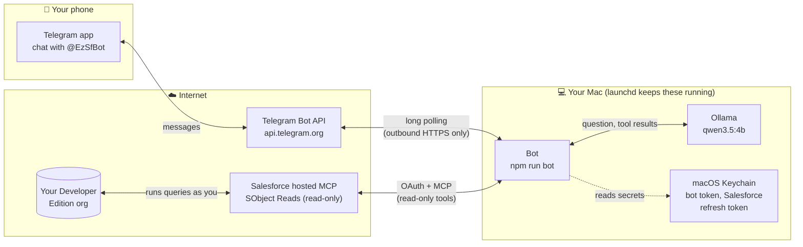
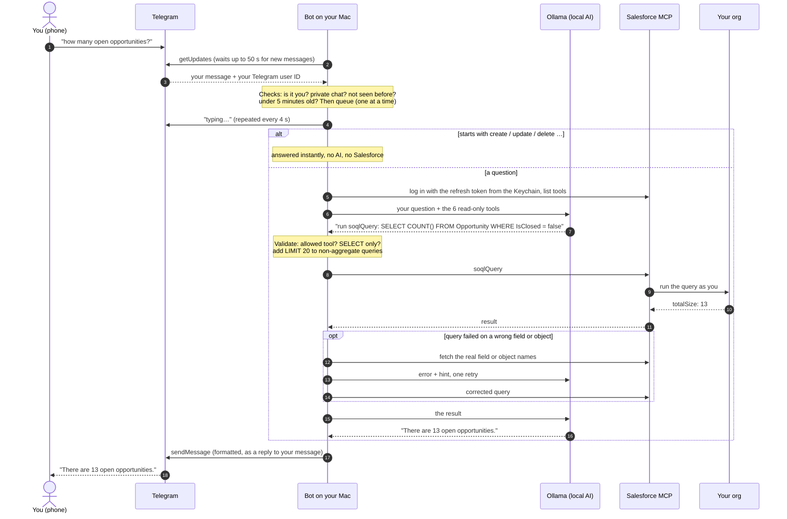

# SF WhatsApp Copilot

Ask questions about your personal Salesforce Developer Edition org from your phone, and get answers in seconds. You message a **Telegram bot**; a small AI model running **on your Mac** works out the query, reads the data through **Salesforce's hosted MCP server**, and replies in the chat.

- **Read-only:** it can look things up, never create, change or delete records.
- **Private:** only your Telegram account gets answers. The AI runs locally; nothing is sent to an AI provider.
- **Free:** no paid APIs, hosting or services.

> The project started on WhatsApp. That version is built but Meta blocks replies without a verified business, so the chat channel is Telegram. See [WhatsApp (paused)](#whatsapp-paused).

## How it works

### What runs where



The Mac only makes **outgoing** connections. There is no public URL, webhook or tunnel, so nothing on the Mac is reachable from the internet.

### From your message to the reply



A reply usually takes **10–60 seconds**. The first one after the Mac has been idle is slower (up to ~90 s) while the model loads into memory.

### The pieces

| File | Role |
|---|---|
| [src/bot.js](src/bot.js) | Entry point: connects to Telegram, wires everything together |
| [src/telegram/poller.js](src/telegram/poller.js) | Fetches new messages (long polling), backs off on errors |
| [src/inbox.js](src/inbox.js) | Owner-only allowlist, duplicate and stale-message filter, one-at-a-time queue |
| [src/telegram/handler.js](src/telegram/handler.js) | `/start` and `/help`, "typing…", friendly error replies |
| [src/assistant.js](src/assistant.js) | Opens the Salesforce connection and runs the agent for one question |
| [src/agent.js](src/agent.js) | Talks to the model; validates and runs tool calls; retry and error handling |
| [src/ollama.js](src/ollama.js) | Calls the local model |
| [src/mcpClient.js](src/mcpClient.js), [src/sfAuth.js](src/sfAuth.js) | Salesforce MCP connection and OAuth (PKCE) login |
| [src/keychain.js](src/keychain.js) | Reads and writes secrets in the macOS Keychain |
| [src/telegram/format.js](src/telegram/format.js) | Model Markdown → Telegram formatting (plain-text fallback) |

## Everyday use

The bot and Ollama run in the background (see [Keep it running](#4-keep-it-running)). Just message **@EzSfBot**. Try:

- `show me 3 account names`
- `how many open opportunities are there?`
- `list the opportunity stages and how many opportunities are in each`
- `what fields does the Opportunity object have?`
- `find the contact Rose Gonzalez`
- `what are the connected apps in the org and their authentication settings?`
- `which OAuth scopes does my external client app have?`

Useful commands on the Mac (in the project folder):

| Command | What it does |
|---|---|
| `scripts/launchd.sh status` | Are Ollama and the bot running? |
| `scripts/launchd.sh logs` | Follow the logs (message IDs and timings only, never message text) |
| `scripts/launchd.sh install` | (Re)start both, e.g. after changing code |
| `npm run ask -- "question"` | Ask from the terminal instead of Telegram |
| `npm run login` | Log in to Salesforce again (when the bot says the login expired) |
| `npm test` | Run the test suite (offline: fake Telegram, fake MCP server) |

## What it can and can't answer

**Can:** anything you can read with a single SOQL query or two on standard objects (accounts, contacts, opportunities, cases, leads, users…), record searches, object fields and picklist values, recently viewed records, and these setup objects: `ConnectedApplication` (connected apps and their access policies), `ExternalClientApplication` and `ExtlClntAppOauthSettings` (External Client Apps and their OAuth scopes).

**Can't:**
- **Change anything.** Only Salesforce's read-only SObject Reads server is connected, and requests starting with create/update/delete/… are refused before the AI runs.
- **Read metadata,** e.g. classic connected apps' OAuth scopes, callback URLs or PKCE settings, page layouts, flows. The read-only data server doesn't expose them.
- **Long multi-step analysis.** It runs at most two queries per message (plus one retry). Split big questions into smaller ones.

The model is small (4B parameters, to fit an 8 GB Mac), so it can still pick a wrong field or misread a result. When a query fails it retries once with the real field or object names; if that fails too, it tells you Salesforce's error.

## Safety and privacy

- **Only you:** messages are processed only from your numeric Telegram user ID (`TELEGRAM_ALLOWED_USER_ID`, which never changes) in a private chat. Anyone else is ignored without a reply.
- **Read-only in three layers:** the Salesforce server itself (SObject Reads only), an allowlist of six read tools, and checks on every call (single `SELECT`, `LIMIT` added, unknown tools blocked).
- **Secrets:** the bot token and Salesforce refresh token live in the macOS Keychain (service `sf-whatsapp-copilot`), never in Git or `.env`. Access tokens stay in memory.
- **Logs** contain message IDs and timings, not message text, phone numbers or tokens.
- **No inbound access:** the Mac only connects out (Telegram, Salesforce, local Ollama).

## Setup from scratch

Needed: a Mac (Apple Silicon, 8 GB+ RAM), Node 22+, Homebrew, a Salesforce Developer Edition org, and a Telegram account.

### 1. Salesforce

1. In Setup → **MCP Servers**, activate **SObject Reads** only.
2. Turn on PKCE in **OAuth and OpenID Connect Settings**.
3. Create an **External Client App** with callback `http://localhost:38000/callback`, scopes `mcp_api` and `refresh_token, offline_access`, **Require PKCE** and **JWT-based access tokens** on, and self-authorized users.
4. In the project:
   ```bash
   npm install && cp .env.example .env
   ```
   Put the app's Consumer Key in `.env` as `SF_CLIENT_ID`. Copy the Consumer Secret, then store it from the clipboard:
   ```bash
   npm run store-secret -- sf-client-secret
   ```
5. Log in (opens the browser; the refresh token goes to the Keychain):
   ```bash
   npm run login
   ```
   Check with `npm run tools`, which lists the six read tools.

### 2. Local AI

```bash
brew install --cask ollama-app && ollama pull qwen3.5:4b
```

(Homebrew's plain `ollama` formula builds from source on macOS 14; the cask is the official prebuilt app.) `npm run test:ollama` checks tool calling offline.

### 3. Telegram

1. In Telegram, message **@BotFather** → `/newbot` → pick a name and a username ending in `bot`. Copy the token.
2. Store it from the clipboard (prints only its length):
   ```bash
   npm run store-secret -- tg-bot-token
   ```
3. Link your account. Open the `t.me/…` link it prints and tap **Start**; it saves your user ID to `.env`:
   ```bash
   npm run telegram:setup
   ```

### 4. Keep it running

```bash
scripts/launchd.sh install
```

This starts Ollama and the bot at login and restarts them if they crash (logs in `~/Library/Logs/sf-copilot/`). Undo with `scripts/launchd.sh uninstall`. To run in a terminal instead: `ollama serve` and `npm run bot`. Nothing runs while the Mac sleeps; Telegram keeps messages for 24 hours, but the bot skips any older than 5 minutes.

## Troubleshooting

| Symptom | Fix |
|---|---|
| Bot says "My Salesforce login has expired" | `npm run login` |
| Bot says "Is Ollama running on the Mac?" | `scripts/launchd.sh status`, then `scripts/launchd.sh install` |
| No reply at all | `scripts/launchd.sh logs`; only the linked account gets replies; the Mac must be awake |
| Log says the bot token was rejected (401) | BotFather → `/mybots` → your bot → API Token, copy it, `npm run store-secret -- tg-bot-token`, then `scripts/launchd.sh install` |
| Log says "conflict: another poller…" | Two bots are running (e.g. `npm run bot` in a terminal plus the background one); stop one |
| A secret pasted into `security … -w` doesn't work | That prompt silently cuts input at 128 characters; use `npm run store-secret` instead |

## Configuration

`.env` (git-ignored; template in [.env.example](.env.example)) holds only non-secret settings: `SF_CLIENT_ID`, `TELEGRAM_ALLOWED_USER_ID`, optional overrides (`SF_MCP_URL`, `OLLAMA_HOST`, `OLLAMA_MODEL`) and the paused WhatsApp settings. Secrets are in the Keychain under service `sf-whatsapp-copilot`:

| Keychain account | Contents |
|---|---|
| `sf-client-secret` | External Client App consumer secret |
| `sf-refresh-token` | Salesforce refresh token (written by `npm run login`) |
| `tg-bot-token` | Telegram bot token |
| `wa-app-secret`, `wa-access-token`, `wa-verify-token` | WhatsApp (paused) |

## Project history

| Phase | Scope | Status |
|---|---|---|
| 0 | Salesforce SObject Reads MCP + External Client App; Claude Code connected | Done |
| 1 | Project skeleton: Git, `.gitignore`, `.env.example`, README | Done |
| 2 | Ollama + `qwen3.5:4b`, tool calling tested offline | Done |
| 3 | Node MCP client with its own OAuth (PKCE), tokens in Keychain | Done |
| 4 | WhatsApp webhook (signature checks, allowlist, dedupe, tunnel) | Built; **blocked by Meta** |
| 4b | Telegram bot (long polling, owner-only), background service | **Live** |
| 5 | Read-only guards, SOQL retry, wrong-object hints, real error messages, redacted logs | Done (a "Reply YES" step only matters if writes are ever enabled) |
| 6 | Optional: Claude Code headless as the brain | Not started |

## WhatsApp (paused)

The WhatsApp Cloud API version works end to end up to delivery: messages arrive, Salesforce answers, Meta accepts the reply. Meta then fails every reply with **131031 "Business Account locked"** because the account needs a verified business, a complete business profile and a payment method. Without a registered business this can't be cleared, so the code is kept but unused.

It's a webhook server instead of polling: `npm run serve` behind an ngrok tunnel (`npm run tunnel`), checking Meta's `X-Hub-Signature-256` signature on every request, with the same inbox rules as Telegram. `npm run serve -- --dry-run` with `npm run simulate -- "question"` tests it locally without Meta. Setup details are in the Git history (commit `72d088f`).

## Cost

- **Salesforce:** only SObject Reads is active. Watch Setup for any Flex Credits or consumption notices.
- **Telegram:** free for bots that reply to their users.
- **AI:** runs locally in Ollama; no API costs.
- **Never add a payment method** to Meta, Salesforce or anything else for this project.
